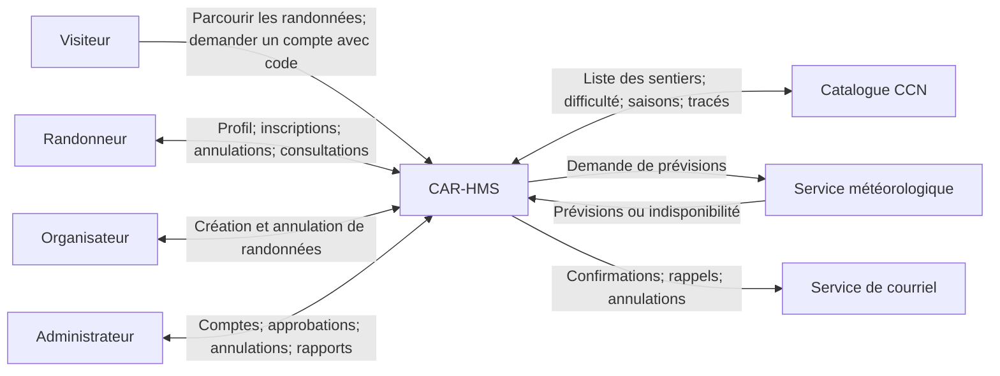

# SEG 3102 — Projet CAR-HMS — Livrable 1 : Domaine initial

**Équipe :** [Nom de l'équipe]  
**Projet :** Système de gestion des événements de randonnée du Cairn (CAR-HMS)  
**Cours :** SEG 3102 — Automne 2026 *(les documents reçus indiquent SEG 3102; vérifier avec le cours)*  
**Professeur :** [Nom à confirmer]  
**Date de remise :** [Date à confirmer]  
**Membres :** [Prénoms, noms et numéros d'étudiant]  
**Livrable :** 1 — Domaine initial

## 1. Sommaire exécutif

Ce document présente l'analyse initiale du domaine du système CAR-HMS à l'intention du professeur, de l'équipe de développement et des représentants du Club de randonnée Cairn. Il énonce les hypothèses de conception, décrit le contexte du système, classe ses sous-domaines et spécifie les douze cas d'utilisation au moyen de préconditions, de scénarios et de postconditions. Il présente aussi les principaux écarts des exigences initiales et les choix de résolution qui guideront les contrats et la structure Kotlin du projet.

## 2. Description de l'équipe et des rôles

| Membre et numéro d'étudiant | Rôle et tâches réellement effectuées | Heures | Contribution |
|---|---|---:|---:|
| [Membre 1] | [Coordination, revue des exigences, hypothèses] | [À remplir] | [À remplir] |
| [Membre 2] | [Diagramme de contexte, sous-domaines] | [À remplir] | [À remplir] |
| [Membre 3] | [Descriptions des cas d'utilisation] | [À remplir] | [À remplir] |
| [Membre 4] | [Interfaces Kotlin, DTO, contrats Cucumber] | [À remplir] | [À remplir] |
| [Membre 5, si applicable] | [Validation croisée, révision, dépôt GitHub] | [À remplir] | [À remplir] |

**Répartition :** à compléter honnêtement selon les contributions réelles. Si la répartition est déséquilibrée, ajouter une justification factuelle.

## 3. Hypothèses

Les hypothèses ci-dessous sont des décisions d'analyse proposées; elles ne sont pas toutes explicitement prescrites dans CAR-Req-01.

- **H01 — Horodatage :** les dates et heures des événements sont interprétées selon le fuseau horaire Ottawa–Gatineau (America/Toronto); elles sont enregistrées avec leur décalage horaire.
- **H02 — Référentiel :** les données officielles sur les sentiers proviennent de la CCN. Une copie locale en lecture seule des dernières données vérifiées permet de consulter les randonnées si le service est temporairement indisponible. Aucun sentier non validé n'est accepté pour la création.
- **H03 — Difficultés :** correspondance ordonnée proposée : débutant ↔ facile, intermédiaire ↔ modéré, avancé ↔ difficile, expert ↔ très difficile. Le membre peut s'inscrire à une randonnée de difficulté inférieure ou égale à son niveau, ou au maximum un échelon au-dessus; l'organisateur doit avoir un niveau au moins égal à la difficulté.
- **H04 — Liste d'attente :** une randonnée « complète » demeure consultable avant la date limite, afin qu'un randonneur admissible puisse demander sa mise en attente; elle affiche zéro place disponible.
- **H05 — Dates :** la date limite d'inscription doit se situer entre la date de création et le début de la randonnée, et dans les quatorze jours précédant le début (inclusivement).
- **H06 — Identifiants :** un compte est identifié de façon unique par courriel (sans tenir compte de la casse), une randonnée et une inscription ont chacune un identifiant unique; le code d'invitation valide est à usage unique.
- **H07 — Inscriptions uniques :** un randonneur ne peut avoir qu'une inscription non annulée par randonnée; les listes d'attente suivent l'horodatage d'inscription, avec ordre de départage stable en cas d'égalité.
- **H08 — Membres mineurs :** l'inscription d'un mineur exige le nom du tuteur légal ainsi qu'une trace de l'acceptation de la décharge par ce tuteur.
- **H09 — Cycle de vie :** une randonnée ne peut avoir qu'un état courant : OUVERTE, COMPLÈTE, FERMÉE, ANNULÉE ou TERMINÉE. Les transitions sont historisées. Les tâches automatiques portent l'identifiant d'acteur « SYSTEM ».
- **H10 — Vérification des rôles :** un organisateur est un randonneur approuvé par un administrateur, avec une certification encore valide au jour de la randonnée et une adhésion active. Les identités opérationnelles proviennent du contexte d'authentification, et non d'une valeur librement déclarée par le navigateur.
- **H11 — Courriels :** les notifications sont déclenchées après le changement métier, sans annuler la transaction si le service de courriel est temporairement indisponible; le système peut enregistrer une demande d'envoi pour réessai.
- **H12 — Services météo :** l'absence de prévisions n'empêche pas les rappels; ceux-ci partent sans avertissement. La consultation de la météo est sans effet sur la capacité à s'inscrire.
- **H13 — Statistiques :** le « nombre de participants » du rapport désigne le nombre d'inscriptions confirmées pour la période, puisqu'aucune présence réelle le jour de la randonnée n'est suivie.
- **H14 — Hors portée :** l'octroi des adhésions au club et l'émission initiale des invitations sont externes au CAR-HMS; l'application vérifie seulement les invitations déjà reconnues.

## 4. Diagramme de contexte du système

**Frontière du système :** CAR-HMS contient la gestion des randonnées, inscriptions, comptes, accès, notifications et rapports. Les données maîtresses des sentiers restent publiées par la CCN, les prévisions proviennent du service météorologique et l'acheminement technique des courriels est une dépendance externe supposée. La randonnée physique, la gestion des adhésions au club et la création des codes d'invitation sont hors portée.

## 5. Sous-domaines

| Sous-domaine | Classification | Justification |
|---|---|---|
| Gestion des randonnées | **Cœur** | Fonction différenciante du club : créer des événements, valider sentier/saison/organisateur et gérer les états. |
| Inscriptions et liste d'attente | **Cœur** | Logique métier cruciale : places disponibles, admissibilité, FIFO et promotions automatiques. |
| Profils, adhésions et certifications | **Support** | Données nécessaires à l'admissibilité, sans constituer la fonction première de gestion des événements. |
| Catalogue des sentiers CCN | **Support** | Intégration d'une source officielle externe indispensable à la planification, mais non possédée par le club. |
| Notifications et rappels | **Support** | Soutient le déroulement de l'inscription, des annulations et des rappels sans définir l'activité centrale. |
| Identité et contrôle d'accès | **Générique** | Connexion, sessions et droits d'accès sont des capacités réutilisables dans de nombreux systèmes. |
| Rapports d'utilisation des sentiers | **Support** | Analyse administrative dérivée des événements et inscriptions existants. |

Chaque sous-domaine correspond à un sous-paquetage sous `domain` et possède un `README.md`. Les deux sous-domaines cœur traduisent particulièrement les exigences de gestion et de correspondance entre les randonnées et les membres.

## 6. Analyse détaillée des cas d'utilisation

Les priorités sont reprises telles qu'elles figurent dans le document CAR-Req-01; les règles qui ne sont pas directement précisées proviennent des hypothèses de la section 3.

### CU-01 — Parcourir les randonnées (priorité 5)
**Acteurs :** visiteur ou utilisateur enregistré.  
**Préconditions :** l'application est accessible; des informations de randonnée ont été enregistrées.  
**Scénario principal :** (1) L'acteur ouvre le catalogue. (2) Il saisit facultativement un nom de sentier, une date et une difficulté. (3) Le système recherche les randonnées admissibles à l'affichage et les trie chronologiquement. (4) Il affiche titre, date, sentier, organisateur, difficulté et places disponibles. (5) Si l'acteur est un randonneur connecté, le système indique les randonnées adaptées à son niveau.  
**Variantes :** aucun résultat → message explicite; randonnée complète → affichée avec zéro place et possibilité de liste d'attente selon H04.  
**Postconditions :** aucune donnée métier n'est modifiée; les randonnées et leur capacité sont consultables.

### CU-02 — Enregistrer un randonneur (priorité 6)
**Acteur :** membre du club actuellement visiteur.  
**Préconditions :** invitation valide disponible; adresse courriel non utilisée.  
**Scénario principal :** (1) Le membre demande son enregistrement. (2) Le système présente un formulaire. (3) Le membre fournit code d'invitation, courriel, mot de passe, noms, téléphone, adresse, date de naissance, contact d'urgence et niveau d'habileté. (4) Le membre accepte la décharge; pour un mineur, le tuteur la valide et son nom est consigné. (5) Le système vérifie les données et le code. (6) Le compte de randonneur est créé.  
**Variantes :** invitation absente/invalide/utilisée, courriel en double, données obligatoires manquantes ou consentement de tuteur absent → refus avec explication.  
**Postconditions :** compte unique créé avec adhésion active et code consommé, ou aucune création en cas d'échec.

### CU-03 — Se connecter (priorité 10)
**Acteur :** utilisateur enregistré.  
**Préconditions :** compte existant disposant d’identifiants de connexion.  
**Scénario principal :** (1) L'utilisateur ouvre le formulaire de connexion. (2) Il saisit courriel et mot de passe. (3) Le système vérifie les identifiants. (4) Une session authentifiée est créée et les droits du rôle sont appliqués.  
**Variantes :** identifiants incorrects ou compte désactivé → échec sans accès aux opérations protégées.  
**Postconditions :** session sécurisée établie ou utilisateur non authentifié.

### CU-04 — Se déconnecter (priorité 11)
**Acteur :** utilisateur enregistré authentifié.  
**Préconditions :** session existante.  
**Scénario principal :** (1) L'utilisateur choisit « Se déconnecter ». (2) Le système invalide la session ou le jeton applicable. (3) Les fonctionnalités privées ne sont plus accessibles sans nouvelle authentification.  
**Variante :** si la session a expiré, la page de connexion est affichée.  
**Postconditions :** session terminée; aucune donnée de randonnée n'est modifiée.

### CU-05 — S'inscrire à une randonnée (priorité 3)
**Acteur :** randonneur.  
**Préconditions :** connecté; adhésion active; difficulté admissible selon H03; date limite non atteinte; aucune inscription non annulée à la même randonnée.  
**Scénario principal :** (1) Le randonneur consulte une randonnée accessible et en demande l'inscription. (2) Le système vérifie l'admissibilité et la date. (3) Il crée une inscription horodatée. (4) Si une place reste, le statut est « confirmée » et la capacité est actualisée. (5) Si la dernière place est prise, l'état de randonnée devient « complète ». (6) Un courriel de confirmation est demandé.  
**Variantes :** randonnée complète → inscription « en liste d'attente », position FIFO et courriel correspondant; membre inactif, difficulté excessive, date limite passée, doublon → refus.  
**Postconditions :** inscription confirmée ou en attente avec capacité cohérente, ou aucune inscription en cas de refus.

### CU-06 — Annuler une inscription (priorité 4)
**Acteur :** randonneur.  
**Préconditions :** connecté; inscrit en statut « confirmée » ou « en liste d'attente »; date limite non atteinte.  
**Scénario principal :** (1) Le randonneur ouvre ses inscriptions. (2) Il choisit une inscription et confirme son annulation. (3) Le système marque cette inscription « annulée ». (4) Si une place confirmée est libérée et qu'il existe une liste d'attente, la première inscription en attente devient confirmée, et son titulaire est informé. (5) Sinon, une randonnée complète redevient ouverte lorsqu'une place est libre.  
**Variantes :** annulation d'une personne en attente → aucun transfert de place; date limite dépassée → refus.  
**Postconditions :** inscription annulée; liste d'attente et état de la randonnée actualisés atomiquement.

### CU-07 — Mettre à jour un randonneur (priorité 7)
**Acteurs :** randonneur (son profil); administrateur (adhésion et certification).  
**Préconditions :** acteur authentifié et autorisé; profil ciblé existant.  
**Scénario principal :** (1) L'acteur choisit le profil. (2) Le système affiche les données actuelles. (3) Le randonneur modifie ses informations personnelles, ou l'administrateur modifie le statut d'adhésion / les détails de certification et le niveau d'organisateur. (4) Le système vérifie données et droits. (5) Il enregistre les modifications.  
**Variantes :** randonneur tentant de modifier le statut ou le compte d'autrui → refus; dates de certification incohérentes → refus.  
**Postconditions :** informations modifiées selon les privilèges ou données inchangées si refus.

### CU-08 — Fermer une randonnée (priorité 2)
**Acteur déclencheur :** système (planificateur automatique).  
**Préconditions :** date limite atteinte; randonnée ouverte ou complète; randonnée non annulée.  
**Scénario principal :** (1) Le planificateur détecte la date limite. (2) Le système vérifie l'état courant. (3) Il place la randonnée à « fermée ». (4) Il journalise le changement et l'acteur « SYSTEM ». (5) Toute nouvelle inscription ou annulation est refusée.  
**Variantes :** randonnée déjà fermée ou annulée → aucune nouvelle transition; fermeture répétée → sans effet secondaire.  
**Postconditions :** randonnée fermée et historique de transition mis à jour.

### CU-09 — Envoyer un rappel de randonnée (priorité 9)
**Acteurs :** système, service météorologique; bénéficiaires : inscrits confirmés.  
**Préconditions :** randonnée prévue le lendemain, non annulée; inscriptions confirmées existantes.  
**Scénario principal :** (1) Le système sélectionne une randonnée à rappeler. (2) Il récupère les inscrits confirmés. (3) Il consulte les prévisions au point de départ. (4) Il prépare un courriel avec date, heure, sentier et lieu de rassemblement. (5) Si pluie ou neige prévue, il inclut un avertissement. (6) Il déclenche l'envoi aux inscrits confirmés.  
**Variantes :** météo indisponible → rappel sans avertissement; aucun inscrit confirmé → aucun courriel à envoyer; courriel indisponible → notification en attente selon H11.  
**Postconditions :** demandes de rappel enregistrées ou transmises; aucune inscription modifiée.

### CU-10 — Créer une randonnée (priorité 1)
**Acteur :** organisateur de randonnée.  
**Préconditions :** connecté, approuvé et membre actif; certificat valide à la date de l'événement; niveau suffisant; sentier CCN autorisé à la randonnée et ouvert à la saison choisie.  
**Scénario principal :** (1) L'organisateur choisit la création. (2) Il sélectionne un sentier officiel. (3) Il fournit titre, description, date et heure de début, durée, date limite d'inscription et capacité. (4) Le système vérifie le caractère autorisé du sentier, la saison, la difficulté, la validité du certificat et les délais (au plus 14 jours avant l'événement). (5) Il attribue un identifiant unique. (6) Il enregistre l'événement avec statut « ouverte », point de rassemblement au départ du sentier et organisateur responsable.  
**Variantes :** certificat expiré, niveau insuffisant, sentier interdit, saison non admissible, capacité non positive, dates incohérentes → aucun événement créé.  
**Postconditions :** randonnée ouverte, consultable et prête pour les inscriptions, ou aucune création.

### CU-11 — Annuler une randonnée (priorité 8)
**Acteurs :** organisateur responsable ou administrateur.  
**Préconditions :** connecté et autorisé; randonnée existante dont la date de début n'est pas passée; motif fourni.  
**Scénario principal :** (1) L'acteur sélectionne la randonnée. (2) Il saisit le motif. (3) Le système vérifie rôle et horaire. (4) Il marque la randonnée « annulée ». (5) Il marque toutes ses inscriptions confirmées et en attente « annulées ». (6) Il journalise l'auteur de la transition. (7) Il demande les courriels d'information avec le motif.  
**Variantes :** organisateur non responsable, date de début dépassée ou motif manquant → refus; échec de courriel → annulation conservée et notification réessayable.  
**Postconditions :** événement et inscriptions annulés de façon cohérente; participants informés ou demandes d'envoi conservées.

### CU-12 — Générer un rapport d'utilisation des sentiers (priorité 12)
**Acteur :** administrateur.  
**Préconditions :** administrateur connecté; sentier identifié; période avec date de début inférieure ou égale à la date de fin.  
**Scénario principal :** (1) L'administrateur sélectionne un sentier CCN. (2) Il indique les dates du rapport. (3) Le système recherche les randonnées du sentier dans la période. (4) Il calcule nombre de randonnées, nombre d'inscriptions confirmées (définition H13) et nombre de randonnées annulées. (5) Il présente le rapport.  
**Variantes :** période invalide → correction demandée; aucune randonnée → statistiques à zéro.  
**Postconditions :** rapport produit, sans modification des données opérationnelles.

## 7. Revue des exigences — Bonus (cinq observations)

Chaque observation distingue une citation du document initial, la lacune et l'effet concret sur le modèle ou les contrats. Il s'agit de résolutions proposées, à valider avec le client.

1. **Visibilité des randonnées complètes.** Extraits (p. 2 et p. 7) : « Une randonnée est ouverte dès sa création, devient complète lorsque la dernière place est prise »; « Si la randonnée est déjà complète, l'inscription est placée en liste d'attente ». **Problème :** la consultation vise les randonnées ouvertes, mais la liste d'attente exige de pouvoir accéder à un événement complet. **Décision :** conserver les randonnées complètes visibles avant leur limite (H04). **Impact :** option `includeFull` dans `BrowseHikesQuery` et scénario de consultation des événements complets.
2. **Difficulté permise aux membres.** Extraits (p. 2 et p. 7) : « un niveau au-dessus »; « difficulté est au plus d'un niveau supérieure ». **Problème :** les niveaux d'habileté et de difficulté des sentiers portent des libellés distincts; la première formulation n'explicite pas les randonnées plus faciles. **Décision :** correspondance ordonnée et différence maximale d'un palier vers le haut (H03). **Impact :** énumérations `SkillLevel` et `TrailDifficulty` et règle d'admissibilité dans le contrat d'inscription.
3. **État « terminée » absent de la liste fonctionnelle.** Extraits (p. 3) : « considérée comme terminée lorsque sa date est passée »; « ouverte, complète, fermée, annulée ». **Problème :** le cycle de vie décrit cinq états, la liste fonctionnelle en contient quatre. **Décision :** inclure l'état TERMINÉE (H09). **Impact :** `HikeStatus.COMPLETED` et future transition automatique de fin.
4. **Dépendance à la CCN et tolérance aux pannes.** Extraits (p. 1 et p. 3) : « ne tient pas lui-même d'informations sur les sentiers »; « L'indisponibilité du ou des services externes ne doit pas empêcher le système de fonctionner correctement ». **Problème :** la création et la consultation reposent sur une donnée distante qui peut manquer. **Décision :** utiliser une copie locale temporaire des données déjà validées, sans devenir propriétaire des données de sentiers (H02). **Impact :** sous-domaine d'intégration CCN et contrat de consultation résiliente.
5. **Acteur des transitions automatiques.** Extraits (p. 3 et p. 7) : « enregistrer l'utilisateur qui a effectué chaque étape »; « lorsque la date limite d'inscription ... est atteinte. Le système met le statut ... à fermée ». **Problème :** une fermeture automatique ne possède pas d'utilisateur humain. **Décision :** permettre un acteur technique « SYSTEM » dans l'historique (H09). **Impact :** DTO `CloseHikeQuery.actorId` et contrat `fermer_randonnee.feature`.

## 8. Références

[1] *Système de gestion des événements de randonnée du Cairn (CAR-HMS) — Document des exigences initiales*, CAR-Req-01, SEG 3102, Université d'Ottawa, automne 2026, 8 p.  
[2] *SEG 3102 — Projet — Livrable 1 : domaine initial*, Université d'Ottawa, automne 2026, 3 p.  
[3] Commission de la capitale nationale (CCN), informations sur les sentiers, adresse indiquée dans CAR-Req-01 : https://ncc-hub-ncc-ccn.hub.arcgis.com/datasets/c0b7abc0c9a74a0285807ea257ae4e00_1/about.

## 9. Correspondance avec le code remis

Sous-domaines : `domain.hikes`, `domain.registrations`, `domain.members`, `domain.trails`, `domain.notifications`, `domain.identity`, `domain.reporting`. Les neuf interfaces du paquetage `application.usecases` correspondent aux cas CU-01, 02, 05, 06, 07, 08, 09, 10 et 11. Onze commandes sont définies (CU-07 comprend trois commandes). Chacune possède un DTO de requête et un contrat Cucumber distinct sous `src/test/resources/contracts`. Les cas CU-03, 04 et 12 sont documentés, mais leurs interfaces sont volontairement omises conformément à la consigne.
