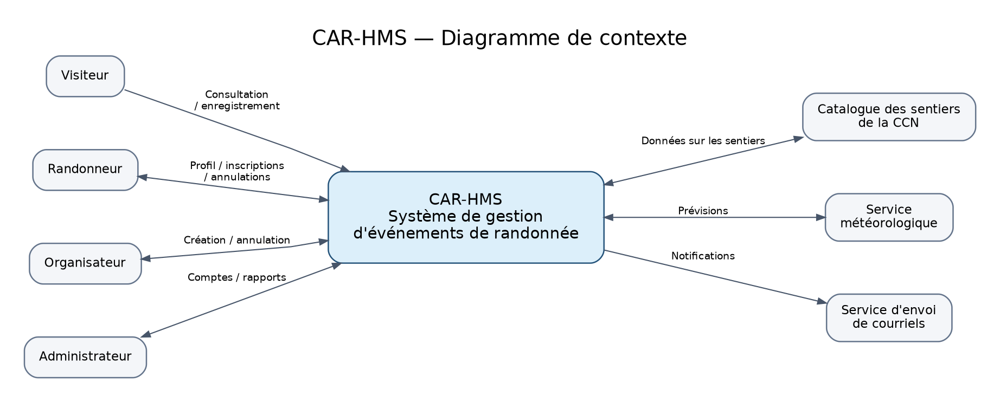

# Contexte du système CAR-HMS

Cette vue précise les interactions du diagramme de contexte et leur correspondance avec les sous-domaines du code. Elle reprend les sections 4 et 5 du rapport de l'équipe, *SEG 3502 - Livrable 1*, et les sections 1.3, 1.5 et 3.2 de CAR-Req-01.

Le fichier [diagramme_contexte.dot](../diagramme_contexte.dot) est la source du diagramme. CAR-HMS est la frontière applicative : les acteurs et les services représentés autour de lui sont externes au système.

## Acteurs et interactions

| Acteur | Interactions avec CAR-HMS | Sous-domaines concernés |
|---|---|---|
| Visiteur | Consulter les randonnées et demander un compte avec un code d'invitation reconnu. | `hikes`, `trails`, `members`, `identity` |
| Randonneur | Gérer son profil, consulter les randonnées, s'inscrire et annuler ses inscriptions avant la limite. | `members`, `hikes`, `registrations`, `identity` |
| Organisateur | Créer et annuler ses randonnées, en plus de ses activités de randonneur. | `hikes`, `members`, `trails`, `identity` |
| Administrateur | Administrer les statuts d'adhésion, approuver les organisateurs, annuler des randonnées et consulter les rapports. | `members`, `hikes`, `registrations`, `reporting`, `identity` |

Un visiteur n'a pas de rôle authentifié et ne peut pas s'inscrire à une randonnée. Un organisateur est un randonneur approuvé, avec les qualifications décrites dans `members`. Les rôles de `identity` décrivent les droits attendus; leur vérification sera réalisée dans une future implémentation.

## Services externes

| Service | Échanges attendus | Sous-domaine responsable de l'intégration |
|---|---|---|
| Catalogue des sentiers de la CCN | CAR-HMS consulte les données officielles : difficulté, saison, activités permises et emplacement du point de départ. Il ne modifie pas le catalogue de la CCN. | `trails` |
| Service météorologique | CAR-HMS demande les prévisions pour le point de départ et la date de la randonnée; le service renvoie les prévisions ou est indisponible. | `notifications` |
| Service de courriel | CAR-HMS lui transmet les demandes de confirmation, de position en attente, de promotion, d'annulation et de rappel. | `notifications` |

Selon H02, une copie locale des dernières données CCN vérifiées soutient la consultation pendant une panne. Selon H11 et H12, une panne de courriel permet de conserver une demande d'envoi et une panne météo permet de préparer le rappel sans avertissement. Les règles d'inscription restent sous la responsabilité de `registrations`.

## Frontière et exclusions

CAR-HMS conserve les profils, les statuts d'adhésion nécessaires à l'admissibilité, les certifications, les randonnées, les inscriptions et l'historique des changements. L'attribution initiale d'une adhésion au club, l'émission et la distribution des invitations, l'organisation physique et le suivi des présences le jour de la randonnée restent hors portée. Modifier le statut enregistré d'une adhésion ne signifie donc pas gérer le processus d'adhésion du club.

Le planificateur de fermeture et de rappel fait partie du comportement interne de CAR-HMS. `SYSTEM` désigne l'auteur technique des transitions automatiques (H09); il ne s'agit pas d'un rôle d'utilisateur.

La [carte des sous-domaines](../src/main/kotlin/ca/uottawa/seg3102/carhms/domain/README.md) décrit le découpage interne. Au Livrable 1, cette répartition exprime des responsabilités de conception : les intégrations et les services métier ne sont pas encore implémentés.
